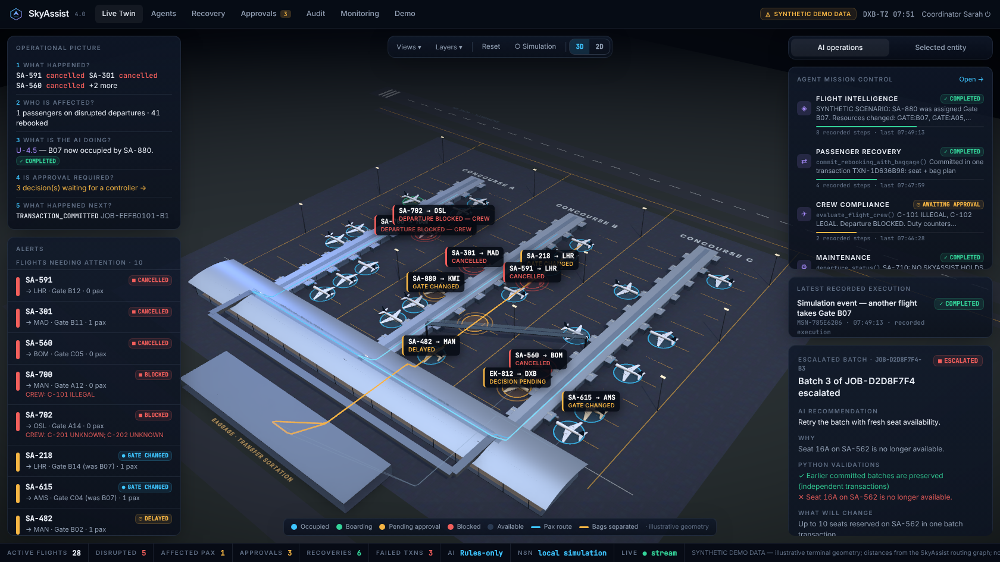
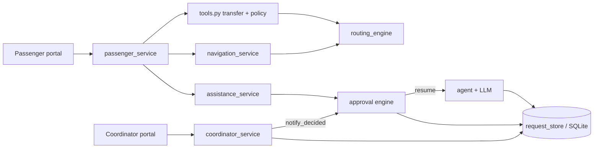

# ✈️ SkyAssist 4.0: 3D airport digital twin + agentic operations command centre

**TechX Dubai '26 · AI Agent Arena · University Track · Domain 4: Aviation & Airport Operations**

SkyAssist 4.0 adds an **immersive 3D airport digital twin** (Next.js + React Three Fiber) as a new interface to the
existing SkyAssist backend. It does not replace the backend. The airport becomes the main way to see operations.
Every gate colour, aircraft tag, route and agent status comes from the database. **Eight specialist agents** act only
through enforced tool allowlists over the deterministic Python services. A controller approves every risky action,
and every step is audited. 2.0, 3.0 and Round 3 are preserved: the 239 original tests are byte-identical and still
pass, and the Streamlit app remains the fallback.



| Route | What a judge sees |
|---|---|
| `/occ` | Command centre: 3D twin (click gates/aircraft), five-question operational picture, alerts, agent mission control, next approval |
| `/demo` | Guided, deterministic 5-stage story: identify → investigate → recover → **your** approval → result + audit |
| `/recovery` | Recovery Simulator: 8 controls that run real backend operations, BEFORE/AFTER twins, diff of backend snapshots, U-4.1…U-4.5 views |
| `/approvals` | Approval Centre: recommendation, Python validations, state change, risks, expiry, state version; APPROVE / DECLINE / REQUEST REASSESSMENT / EXECUTE |
| `/agents` | Agent Mission Control: 8 agents, allowlists, recorded executions, alert intake, permission boundary test |
| `/audit` · `/monitoring` | Append-only audit with filters + CSV · Gemini → Groq → rules health, breaker, timeouts, burst, cost |
| `/passenger` | Mobile passenger portal (sign in `PNRBAG` / `demo123`) |

**Run it (one process, one port):**

```bash
pip install -r requirements-dev.txt                 # Python 3.11+
uvicorn api.server:app --host 127.0.0.1 --port 8600 # serves /web API + prebuilt frontend/out + unchanged /v1 n8n API
# open http://127.0.0.1:8600  → sign in sarah / coord123 (synthetic demo account)
```

Rebuild the frontend (optional; `frontend/out` is prebuilt): `cd frontend && npm ci && npm run build`.
Frontend dev mode: `uvicorn api.server:app --port 8600` + `cd frontend && npm run dev` → http://localhost:3000.

| Task | Command |
|---|---|
| Load / reset the synthetic airport | automatic on first start · reset in `/recovery` or `POST /web/scenarios/reset` · full rebuild `python build_db.py` |
| Five scenarios | `/recovery` (UI) · or `curl` `POST /web/scenarios/U-4.1/run` … `U-4.5/run` (signed-in controller) · Streamlit `/occ` still works |
| Tests | `python -m pytest -q` (264) · `python run_scenarios.py` (10/10) |
| Browser QA + screenshots | `pip install playwright && playwright install chromium && python scripts/qa_browser_v4.py all` |
| API latency benchmark | `python scripts/bench_v4.py` |
| n8n | unchanged — see [`docs/v3/N8N.md`](docs/v3/N8N.md) (`/v1/*` on the same port) |
| AI providers (optional) | `GEMINI_API_KEY`, `GROQ_API_KEY` in the environment; without them SkyAssist runs rules-only and says so |

**4.0 docs:** [architecture (C4, agents, data flow, sequences)](docs/v4/ARCHITECTURE.md) ·
[preservation register](docs/v4/PRESERVATION.md) · [test results](docs/v4/TEST_RESULTS.md) ·
[screenshots](docs/v4/screenshots/)

**Honest limits:** synthetic data and illustrative terminal geometry (distances from the routing graph); no live
airport, aircraft or passenger tracking; animated movement only in labelled simulation; demo authentication; sessions
in memory; Omniverse/OpenUSD is a prepared interface, **not connected**; frame rate not yet benchmarked on the demo
laptop.

---

# ✈️ SkyAssist 3.0: airport operations control, built on the 2.0 passenger platform

**University Track, Domain 4: Aviation & Airport Operations**

SkyAssist 3.0 adds an **Operations Control Centre** (`/occ`) that solves the five OCC challenges with deterministic,
audited, transaction-safe Python — while keeping every 2.0 feature (strict superset: the original 81 tests still pass,
byte-identical).

| Challenge | What SkyAssist does |
|---|---|
| **U-4.1** Vulnerable passengers first | Recorded WCHR/UMNR/ELDERLY passengers are committed first in their own transaction; the rest go in batches of 10, each its own transaction. A batch-3 seat conflict rolls back only batch 3, retries on fresh availability, then escalates. |
| **U-4.2** Crew duty legality | Crew messages are stored as untrusted data and cannot change counters. 20 min remaining vs 40 required → ILLEGAL, departure blocked, legal reserve proposed; legality re-checked at execution; unverified rules fail closed. |
| **U-4.3** Maintenance sign-off | An "OK" is a claim: 10 deterministic checks (roster, licence, type, scope, registration, timeline, integrity, evidence). Invalid → kept unchanged, alert, aircraft stays blocked. |
| **U-4.4** Passenger & baggage | 35 min passenger connection vs 45 min bag minimum → seat, bag re-routing and delivery note commit together or not at all (4 injected failure points tested). |
| **U-4.5** Stale approvals | Approvals bind to resource versions + snapshot hash. EK-812 → B7 approved, B7 then given to another flight → STALE, refused, fresh proposal staged for a new decision. |

- 🌐 **Live app:** https://skyassist-xjyx2wd6jqei4yxmjcr3wz.streamlit.app (open `/occ`, sign in `sarah` / `coord123`)
- 🖥️ **Pitch deck (website):** https://skyassist-pitch.vercel.app · 2.0 deck at [/v2.html](https://skyassist-pitch.vercel.app/v2.html)
- 🎬 **3.0 demo video:** [`docs/SkyAssist3_demo.mp4`](docs/SkyAssist3_demo.mp4) (108 s)
- **Results:** 204 tests passed (81 original + 123 new) · scenarios 10/10 · red team **20/20 blocked** · five n8n workflows imported and run end to end on a real n8n 2.48.7 — see [`docs/v3/TEST_RESULTS.md`](docs/v3/TEST_RESULTS.md)
- **Docs:** [architecture (C4)](docs/v3/ARCHITECTURE.md) · [schema](docs/v3/SCHEMA.md) · [API](docs/v3/API.md) · [n8n](docs/v3/N8N.md) · [demo guide](docs/v3/DEMO_GUIDE.md) · [preservation register](docs/v3/PRESERVATION.md) · [limitations](docs/v3/LIMITATIONS.md) · [red team](docs/REDTEAM.md) · [performance](docs/PERFORMANCE.md)
- **Screenshots:** [`docs/screenshots/v3/`](docs/screenshots/v3/)

```bash
python -m streamlit run app.py          # then open /occ and sign in as sarah / coord123 (demo account)
pip install -r requirements-api.txt && uvicorn api.app:app --port 8600   # optional workflow API (see docs/v3/API.md)
python -m pytest -q                     # 204 tests
python scripts/redteam.py               # 20 attacks
```

> All operational data is **synthetic**. Duty limits, the bag minimum connection time and every roster, licence and
> defect are demonstration data, labelled as such. No LLM is used in any OCC decision.

---

## SkyAssist 2.0 (preserved in full)

SkyAssist 2.0 has two portals on one shared backend:

- **Passenger portal** (`/passenger`, mobile-first). Passengers see their verified next gate, the time left, an honest connection-risk rating and step-by-step indoor directions on a terminal map. They can also track their assistance request.
- **Coordinator portal** (`/coordinator`, desktop-first). Airport staff get a live queue of requests ordered by risk, the passenger's route on the same map, deterministic calculations, approve/decline decisions recorded exactly once, staff and cart assignment, and a full audit history.

The design rule is the same as in v1: **the AI assists, deterministic code calculates, a human authorises, and the passenger always gets truthful information.**

> All data is **synthetic demonstration data**. No live flight feed, indoor positioning or dispatch system is connected, and the UI says so wherever it matters.

---

## Quick start

```bash
python -m pip install -r requirements.txt
python -m streamlit run app.py                 # builds the synthetic DB on first run, migrations after that
```

| Route | Who | Demo sign-in (synthetic) |
|---|---|---|
| `http://localhost:8501/` | Landing page | n/a |
| `/passenger` | Passenger | Booking `PNR1A2` (S1 family), password `demo123` |
| `/coordinator` | Coordinator | `sarah` or `aisha`, password `coord123` |
| `/operations` | Coordinator | Connection board, synthetic-data simulator, audit log |
| `/occ` | Coordinator / OCC controller | **3.0** Operations Control Centre: five challenge workspaces, scenario launcher, audit, outbox |

Passwords come from `PASSENGER_DEMO_PASSWORD` and `COORDINATOR_DEMO_PASSWORD` (see `.env.example`) and are stored PBKDF2-hashed. **This is demonstration authentication, not production identity verification.**

Optional LLM: Ollama `qwen3` → `GEMINI_API_KEY` → `GROQ_API_KEY` → offline rules mode. Everything works with no LLM at all.

## Tests

```bash
pip install -r requirements-dev.txt
python -m pytest -q                   # 204 tests (81 from 2.0 + 123 for 3.0)
python run_scenarios.py               # original S1–S10 in the terminal → 10/10
# browser demo (app running on a fresh DB):
python tests/e2e_browser_demo.py shots approve      # or: decline
```

**Latest results (3.0):** `204 passed` (the 81 2.0 tests unchanged and passing) · `run_scenarios.py` 10/10 · browser demo: approve and decline flows both pass, with no page errors.

---

## Architecture

```
 PASSENGER UI (views/passenger.py)          COORDINATOR UI (views/coordinator.py, views/operations.py)
        │  mobile-first, polling fragments             │  desktop-first, live queue
        ▼                                              ▼
 passenger_service ── assistance_service      coordinator_service   (every call checks the Principal's role)
        │                    │                         │
        └──────────── SHARED SKYASSIST SERVICES ───────┘
   auth_service (RBAC, PBKDF2)      routing_engine (graph + Dijkstra)      tools.py (transfer maths, policy)
   navigation_service (routes, progress)    location_provider (manual; BLE/QR/UWB interfaces)
   request_store (durable lifecycle, atomic transitions)    approval.py (asyncio Futures, agent resume)
   agent.py + llm.py (language only, hallucination guard)   integrations.py (future providers, not faked)
        │
        ▼
 SQLITE (single source of truth; idempotent migrations in database/migrations.py)
```



### Key design decisions
- **One routing engine for everything.** `tools.calculate_terminal_transfer_time()`, the passenger map, navigation steps and the coordinator view all use `services/routing_engine.py`. Distance always comes from summing graph edges, never straight-line distance. Every v1 number is reproduced exactly; `test_numbers_identical_to_v1` checks S1's 1,900 m and 68/34 min.
- **Accessible routing.** Wheelchair, stroller and elderly passengers get **step-free** routes (lifts, no stairs or escalators). Carts get step-free, cart-permitted routes. If no step-free route exists, the passenger sees an error and **never a silent fallback** to a walking route.
- **Durable approvals.** SQLite holds every request state. A decision is one guarded `UPDATE … WHERE status='PENDING'` inside `BEGIN IMMEDIATE`, so concurrent coordinators get exactly one winner. Only after that commit does the system wake the waiting `asyncio.Future`. After a restart, decisions are still read from the database.
- **Approval ≠ dispatch.** The passenger sees APPROVED → (staff assigned) → DISPATCHED → STAFF EN ROUTE → COMPLETED, and each step only after a coordinator records it. A timeout **escalates**; it never approves.
- **Honest risk.** The headline risk uses the *unassisted* plan until assistance is actually approved: S1 shows AT RISK, then TIGHT after approval.
- **Idempotent requests.** One active request per booking, whether it came from the policy, the chat or the passenger themselves.

### Data model (added by migration v2)
`terminal_nodes`, `terminal_edges` (accessible / stairs / escalator / elevator / restricted / cart_ok / available), `gate_locations`, `navigation_routes`, `route_progress`, `users`, `request_events`, `notification_events`, `audit_log`, `staff`, `mobility_resources`, plus new `dispatch_requests` columns (`dispatch_status`, assignment, hold minutes, UTC timestamps, escalation). All v1 tables and data are kept. Migrations are idempotent and covered by a test that runs them twice on a v1 database.

### Correction to the brief (documented)
The 2.0 brief lists S1's arrival gate as **B07**. In the dataset the family arrives at **C12**, and **B07 is the old departure gate** that changed to B14. The brief's own numbers (68 min alone, 34 min by cart, 1 min spare) are the C12 → B14 route, so the data was kept as is.

A related finding from the new graph tests: for an able-bodied walker, C12 → B14 is genuinely shorter via the mezzanine stairs (1,250 m). Step-free travellers can't use the stairs, so S1's wheelchair route stays 1,900 m.

---

## Acceptance tests → where they're covered

| # | Requirement | Test |
|---|---|---|
| 1–3 | Login, own flight, correct gate (outdated gate never used) | `test_passenger_journey.py::test_01_02_03…`, `test_03_outdated_gate_never_used` |
| 4–6 | Valid route, numbered directions, progress persists | `test_04_05…`, `test_06_progress…` |
| 7, 28 | Gate change → recalculated route + notification | `test_07_gate_change…`, `test_routing.py::test_28…` |
| 8, 27 | Wheelchair gets a verified step-free route that avoids stairs and escalators | `test_accessibility.py` |
| 9, 24 | Passenger / anonymous users can't use coordinator functions (backend-enforced) | `test_permissions.py` |
| 10–13 | Pending → approved / declined; never a false dispatch | `test_passenger_journey.py::test_10…test_13` |
| 14–17 | Coordinator login, queue, open request, route + calculations | `test_coordinator.py` |
| 18–22 | Approve / decline, notes recorded, waiting agent resumes | `test_approval.py::test_18…`, `test_19_22…` |
| 23, 35 | Duplicate and concurrent decisions → exactly one wins | `test_23…`, `test_35…` (8 threads) |
| 25, 26 | Shortest path, distance = sum of graph edges | `test_routing.py` |
| 29, 30 | No route → clear error; no destination → no fabricated route | `test_29…`, `test_30…` |
| 31–33 | Pending survives reruns, timeout ≠ approval, many pending at once | `test_approval.py` |
| 34 | Separate users' sessions and data stay isolated | `test_permissions.py::test_34…` |
| 36 | Resolved state after restart (new engine, no Futures) | `test_approval.py::test_36…` |
| S1–S10 | Original scenarios + identical v1 numbers | `test_existing_scenarios.py`, `run_scenarios.py` |
| UI | Portals render; coordinator page refuses a passenger session | `test_integration.py` (Streamlit AppTest) |

---

## Features completed
- Two separate portals on one backend with backend-enforced RBAC. Demo auth uses PBKDF2 with env-configured passwords.
- Passenger home:
  - welcome and booking
  - arriving and connecting flight cards
  - prominent gate-change badge
  - time left, transfer estimate and distance
  - COMFORTABLE / TIGHT / AT RISK with plain-language explanation
- Indoor navigation:
  - SVG terminal map (illustrative, labelled as such) showing hubs, Level 2 skywalks, outer step-free corridor, stairs, lifts and escalators, security, Transfer Desks and assistance points
  - highlighted route with direction arrows, start and destination markers, current and completed steps
  - Start navigation, Previous, Mark step completed, Recalculate, View full route
  - distance and walking time left, arrival instructions
  - manual "update my location" (not live tracking)
- Graph routing engine (Dijkstra) with STANDARD / STEP_FREE / CART profiles, closures, rerouting and clear no-route errors.
- Assistance tracker covering every state; notifications feed; passenger self-service request form.
- Chat answers from the backend: next gate, timing, "has my assistance been approved?", nearest assistance desk, running late. English and Hinglish.
- Coordinator dashboard:
  - KPIs computed from the database
  - queue sorted AT RISK → TIGHT → COMFORTABLE, then least time left
  - filters (Pending, Approved, Declined, Escalated, Wheelchair, Escort, Mobility cart, Gate hold)
- Coordinator request detail:
  - passenger and flights
  - deterministic calculation box kept separate from the guarded AI/template summary
  - route map, suggested resources, agent trace, status timeline
- Coordinator actions:
  - decisions only after an explicit "reviewed" confirmation
  - staff and cart assignment that refuses resources already in use
  - gate hold capped at 10 min
  - dispatch lifecycle
  - warning when the gate changed after the request was created
- Operations page:
  - live connection board for all bookings
  - synthetic-data simulator: gate changes, closing and reopening corridors or lifts
  - audit log
- Durable lifecycle, atomic transitions, escalation, UTC storage with local display, idempotent migrations and indexes.
- Future-ready interfaces, deliberately **not** connected: live flight provider, SkyOps Twin topology provider, BLE/QR location providers, dispatch provider, notification channels.

## Not yet implemented
- Real airport data (OpenSky / OurAirports / AODB), live indoor positioning, a real dispatch or staff system, SMS or push notifications.
- Production identity (OIDC/SAML), sessions that survive server restarts, rate limiting.
- Multi-floor detail beyond the two levels, live lift status, live crowding or queue times at security.
- Stretch goals from v1: baggage and mobility-aid delivery tracker, quiet-room finder, audio guidance cards.
- Arabic/Urdu UI (the chat handles English and Hinglish; other languages depend on the LLM).

## Known limitations and production readiness
- **The terminal clock is simulated** per scenario, so "time remaining" doesn't count down. A real deployment would use the actual clock and flight feed.
- **Streamlit refreshes by polling** every 3–5 s, which is fine for a pilot. A large airport would want push updates and a separate API layer, and the services layer is already UI-independent to allow that.
- **SQLite** with WAL handles a single-site pilot. Moving to PostgreSQL means swapping `db.py` and the migration runner; the SQL is standard apart from `INSERT OR IGNORE`.
- **The approval Futures live in the Streamlit process.** Durable state is in SQLite, so a restart loses only the in-chat "resume" message, not the decision. The portal and notifications always reflect the stored decision.
- **Coordinates are schematic, not surveyed.** Distances reproduce the v1 dataset.
- **Readiness: a credible pilot-grade MVP, not production.** Before production it needs a security review, real identity, hosted infrastructure, monitoring, accessibility testing with real users, and validation of the walking-speed and buffer constants with airport operations staff.

## Project layout
```
app.py                      router (st.navigation): /, /passenger, /coordinator, /operations, /occ
views/                      home.py, passenger.py, coordinator.py, operations.py, occ.py (3.0)
services/ops/               3.0: foundation, rebooking, baggage, crew, maintenance, gate_approvals, outbox, simulator, seed
api/app.py                  3.0: authenticated FastAPI adapter for n8n
n8n/                        3.0: build_workflows.py + workflows/A–E (importable, no secrets)
database/migrations_v3.py   3.0: additive schema v3
scripts/                    redteam.py, perf.py, n8n_e2e.py
components/                 ui.py (design system), airport_map.py (SVG map), session.py (sign-in)
services/                   routing_engine, navigation_service, passenger_service, assistance_service,
                            coordinator_service, request_store, auth_service, location_provider, integrations
database/migrations.py      idempotent schema v2 + seeds (graph, staff, carts, demo users)
agent.py llm.py tools.py approval.py db.py build_db.py run_scenarios.py   (v1 core, extended)
tests/                      204 pytest tests + e2e_browser_demo.py
```
