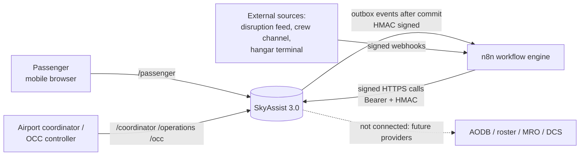
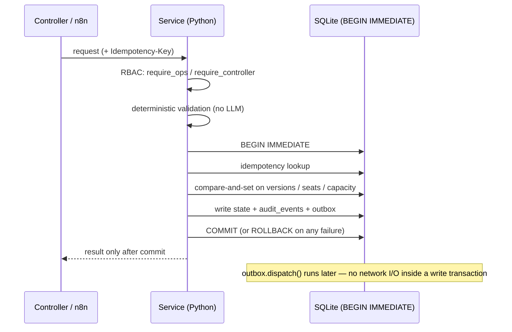

# SkyAssist 3.0 — architecture

**Design rule:** deterministic Python decides; n8n orchestrates; a human approves; every critical step is audited.
The LLM layer from v1/v2 is unchanged and is never on a safety-critical path. None of the five OCC modules calls it.

## C4 level 1 — system context



## C4 level 2 — containers

```mermaid
flowchart TB
  subgraph Streamlit app [Streamlit app — app.py router]
    P[views/passenger.py]:::v2
    C[views/coordinator.py]:::v2
    O[views/operations.py]:::v2
    OCC[views/occ.py — NEW]:::v3
  end
  API[FastAPI adapter api/app.py — NEW<br/>SERVICE principal, Bearer + HMAC,<br/>pydantic strict schemas, idempotency]:::v3
  subgraph Services [Python services — the only place decisions are made]
    V2[v2: routing, passenger, assistance,<br/>coordinator, request_store, auth]:::v2
    OPS[v3 services/ops: rebooking, baggage, crew,<br/>maintenance, gate_approvals, foundation,<br/>outbox, simulator, seed]:::v3
  end
  DB[(SQLite WAL<br/>schema v1 → v2 → v3, additive)]
  N8N[n8n workflows A–E]:::v3
  P & C & O --> V2
  OCC --> OPS
  API --> OPS
  V2 --> DB
  OPS --> DB
  OPS -->|workflow_outbox rows<br/>written in the same transaction| DB
  DB -->|outbox.dispatch() after commit| N8N
  N8N --> API
  classDef v3 fill:#e0ecff,stroke:#1d4ed8
  classDef v2 fill:#f1f5f9,stroke:#64748b
```

## C4 level 3 — the pattern every critical action follows



## Module map (challenge → code)

| Challenge | Service | Key guarantees |
|---|---|---|
| U-4.1 | `services/ops/rebooking.py` | Vulnerable (recorded needs only) committed first in their own transaction; batches of 10, each its own transaction; CAS seat reservation; retry with fresh availability; escalation; never one job-wide transaction |
| U-4.2 | `services/ops/crew.py` | Messages stored as untrusted data with flags; immutable rule profiles; no write path to counters; UNKNOWN fails closed; legality re-checked at execution |
| U-4.3 | `services/ops/maintenance.py` | Immutable sign-offs (triggers); 10 deterministic checks + result check; invalid kept and alerted; valid clears only its defect; final release stays outside SkyAssist |
| U-4.4 | `services/ops/baggage.py` | Passenger + bag feasibility; seat, booking, bags, delivery note, history, notification, audit, idempotency in one transaction; injected-failure rollback |
| U-4.5 | `services/ops/gate_approvals.py` | Snapshot hash + resource versions; CAS at execution; STALE + re-stage; target-mismatch, replay, expiry, double-execution refused |
| Shared | `services/ops/foundation.py`, `outbox.py` | Append-only audit, idempotency records, versions, alerts, outbox |
