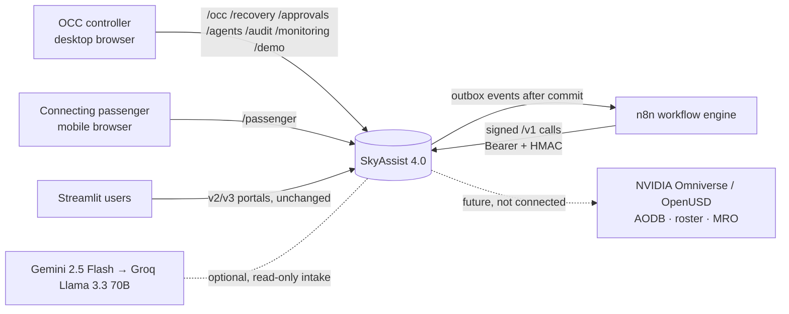
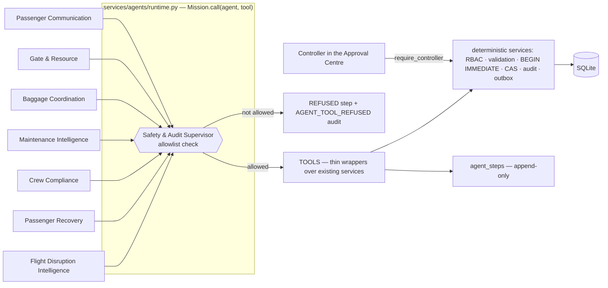
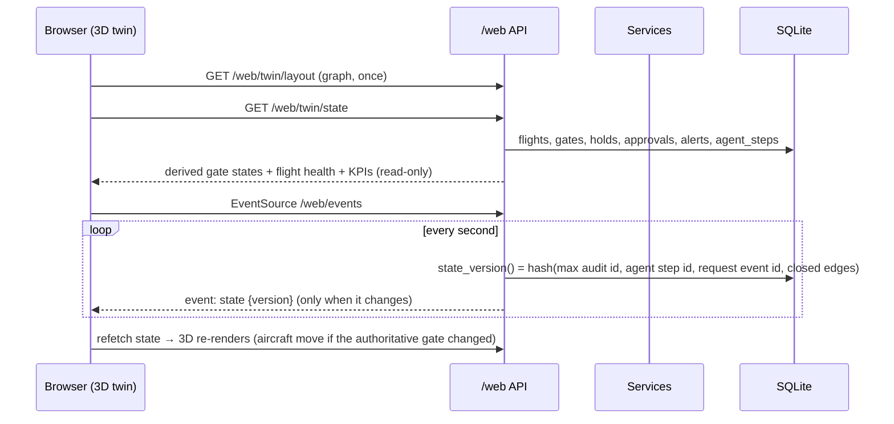
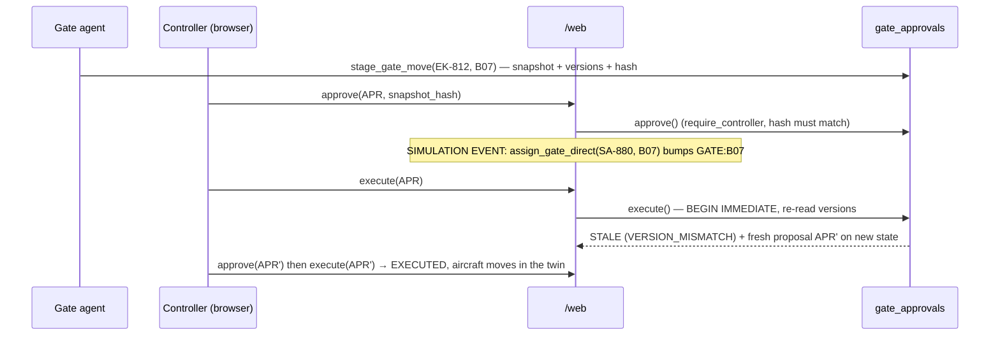

# SkyAssist 4.0 — architecture

**Design rule (unchanged from 3.0):** deterministic Python decides · the database is authoritative · n8n orchestrates ·
a human approves · every critical step is audited. 4.0 adds a **3D digital-twin web interface** and an **agent layer
with enforced tool allowlists** on top of the existing services. Nothing in the 3D layer computes crew legality, seat
availability, baggage feasibility, maintenance clearance or approval validity — it renders verified backend state.

## 1. System context (C4 level 1)



## 2. Containers (C4 level 2)

```mermaid
flowchart TB
  subgraph Browser
    TW[Next.js 16 static export<br/>React 19 · React Three Fiber · drei · Zustand · TanStack Query]
  end
  subgraph "Python process (uvicorn api.server:app, one port)"
    WEB["/web/* — api/web.py (NEW)<br/>human sessions, HttpOnly cookie, CSRF header"]
    V1["/v1/* — api/app.py (UNCHANGED)<br/>n8n SERVICE principal, Bearer + HMAC, can never approve"]
    STATIC["/ — frontend/out (static)"]
    AG["services/agents (NEW)<br/>registry · runtime · missions"]
    TWIN["services/twin (NEW)<br/>read models · geometry sources"]
    OPS["services/ops (3.0)<br/>rebooking · crew · maintenance · baggage · gate_approvals · journey · burst · outbox"]
    V2S["services (2.0)<br/>routing · passenger · assistance · coordinator · auth"]
  end
  ST[Streamlit app — app.py (UNCHANGED fallback)]
  DB[(SQLite WAL<br/>schema v1→v2→v3 + v4 agent record, additive)]
  N8N[n8n workflows A–F]
  TW -->|fetch + SSE /web/events| WEB
  TW --> STATIC
  WEB --> AG --> OPS
  WEB --> TWIN --> DB
  WEB --> OPS & V2S
  V1 --> OPS
  ST --> OPS & V2S
  OPS --> DB
  V2S --> DB
  DB -->|outbox.dispatch()| N8N --> V1
```

## 3. Components (C4 level 3) — frontend

The rendering layer is independent of business logic and split by responsibility:

| Component | File | Responsibility |
|---|---|---|
| AirportScene | `components/twin/AirportScene.tsx` | Canvas, lights, environment, camera rig, post-processing, performance fallback |
| TerminalModel | `components/twin/TerminalModel.tsx` | Ground, runway, main terminal, piers (ConcourseLayer), skywalk, mezzanine, baggage hall |
| GateObject | `components/twin/GateObject.tsx` | Holdroom pod, boarding bridge, stand ring coloured by **backend** gate status |
| FlightObject | `components/twin/FlightObject.tsx` | Procedural aircraft, health tint, tag, illustrative ground-move animation on a real gate change |
| PassengerRouteLayer / BaggageRouteLayer | `components/twin/RouteLayers.tsx` | Routes from the Dijkstra engine; bag legs from `bag_flight_assignments`; synthetic dots only when Simulation is on |
| layout3d | `components/twin/layout3d.ts` | Illustrative placement derived from graph topology (no invented connections; distances from edges) |
| Twin2D | `components/twin/Twin2D.tsx` | 2D fallback (auto when WebGL is unavailable, or `?mode=2d`) |
| OperationalAlertPanel, AgentActivityPanel, EntityPanel, ApprovalCard, MissionTimeline, Situation | `components/panels/*` | Panels; every value comes from `/web/*` |

## 4. Agent interaction



Tool kinds: **READ**, **VALIDATE** (deterministic Python), **STAGE** (proposal for a human), **COMMIT** (only the
commits the existing policy already allows without a human: U-4.1 batches, U-4.4 atomic seat+bag, Round 3 safe
actions), **NOTIFY** (template wording from committed records). There is **no** tool for approve, execute, duty-limit
change, aircraft release or seat-inventory override (`HUMAN_ONLY` in `registry.py`); `tests/test_v4_web.py` asserts it.

LLM use is unchanged from Round 3: only the alert-intake step (Gemini → Groq → rules) and fact-guarded summaries.
No agent decision depends on an LLM.

## 5. Digital-twin data flow



## 6. Operational event sequences

**U-4.5 stale approval (all decisions human):**



**Round 3 alert through the agents:** `Mission.call(flight_intel, process_alert)` runs the unchanged journey
(checks → injection screen → AI intake → validate → route → act/pause → output); each recorded journey step is then
attributed to the responsible agent in `agent_steps` (it is not re-executed).

## 7. SOLID notes

* **S** — scene, layout mapping, layers, panels, API client and store are separate modules; Python read models
  (`services/twin/state.py`) are separate from write services.
* **O** — new geometry sources plug in behind `TwinGeometrySource` (`services/twin/geometry_sources.py`); new agents are
  registry entries, not new code paths.
* **L/I** — every tool has the same `(principal, **kwargs)` shape; agents see only their allowlist.
* **D** — the frontend depends on the `/web` contract, never on tables; agents depend on the toolbox, never on SQL.

## 8. Future: NVIDIA Omniverse / OpenUSD

`GET /web/twin/geometry` returns the active geometry source. Today: `procedural-graph` (default) or `approved-glb`
(`SKYASSIST_TWIN_GLB=/models/terminal.glb`, file placed in `frontend/public/models`). `OpenUSDSource`
(`SKYASSIST_TWIN_USD=omniverse://…`) reports **NOT_CONNECTED**: the interface exists, a live Omniverse connection does
not. Operational state never comes from a geometry source.
